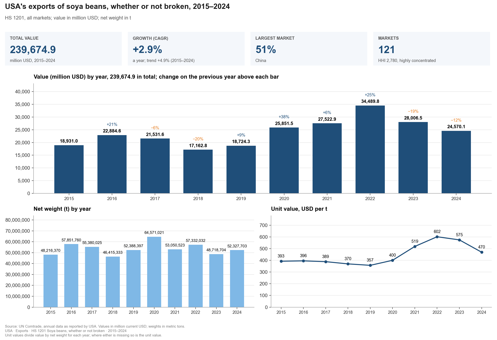
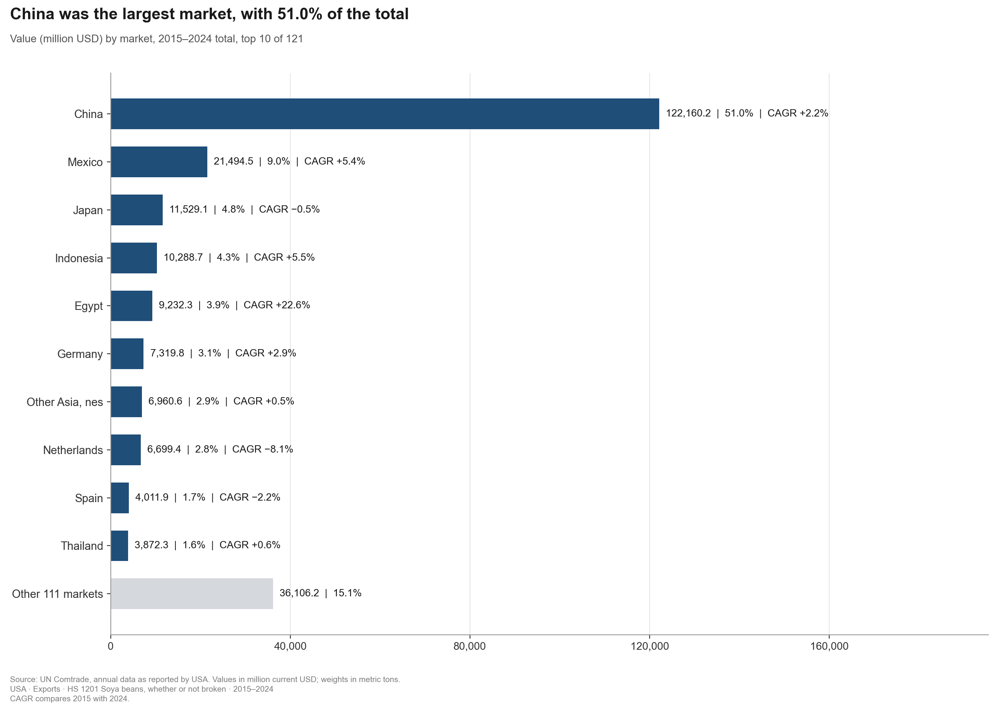
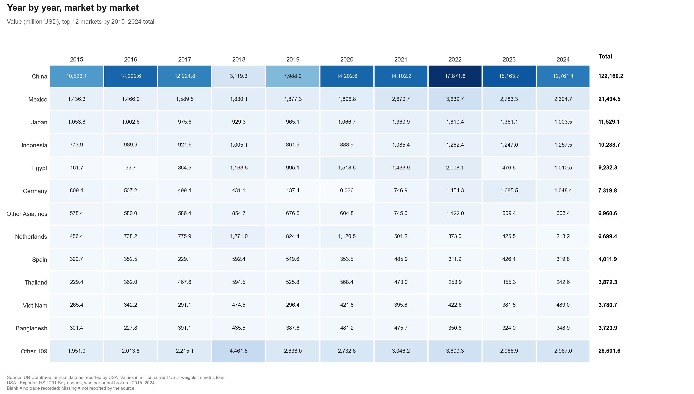
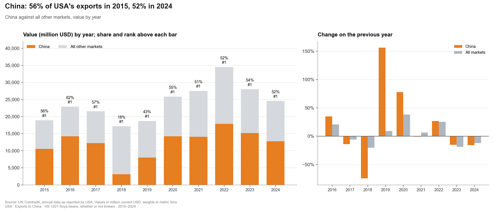
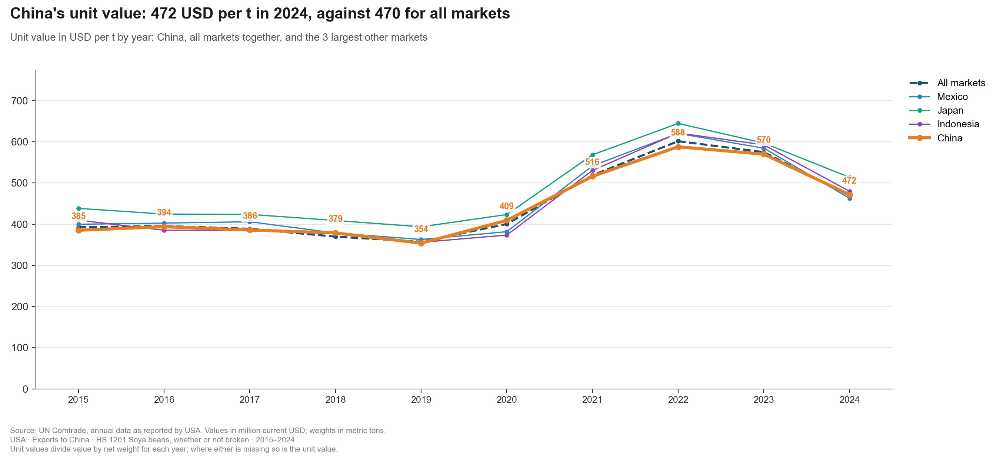
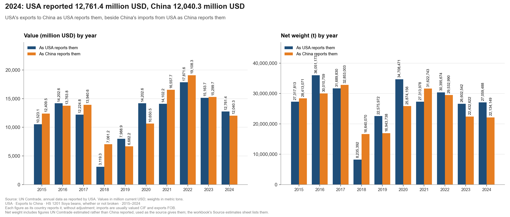
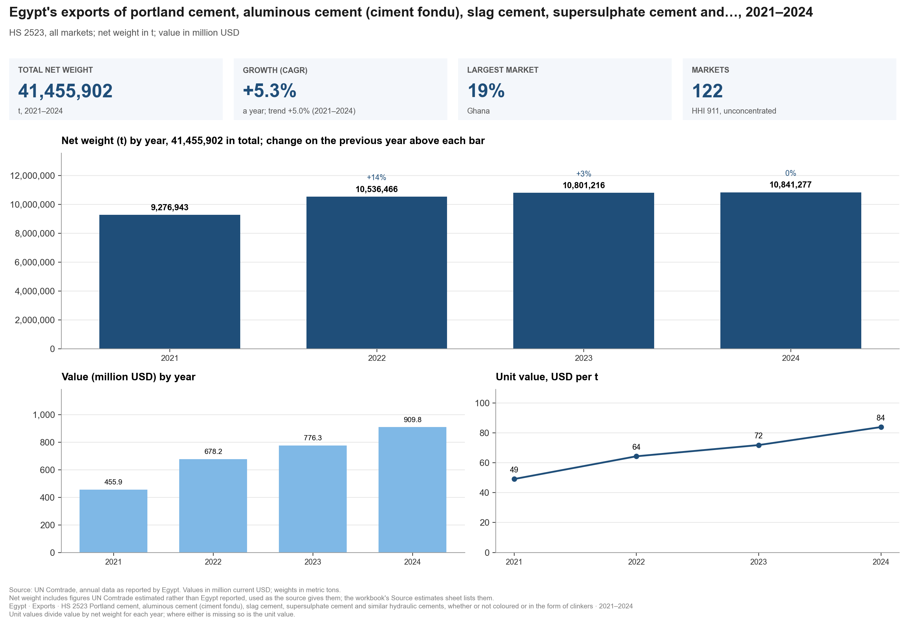

# International Trade Analyzer

A Python tool for analyzing international bilateral trade flows with the **UN COMTRADE API**, the trade statistics countries report to the United Nations, and the **BACI database**, which CEPII builds from the same reports.

---

## Overview

The International Trade Analyzer enables researchers, economists, policy analysts, and trade professionals to explore and visualize global trade patterns with ease. Whether you're investigating a country's top trading partners for a specific commodity or analyzing trade trends over three decades, this tool provides the flexibility and depth needed for robust trade analysis.

Every query produces a folder with an Excel workbook holding the full query data and its analysis, report-ready charts, a Word report and a Markdown summary.

### Key Features

- **Dual Data Source Support**
  - **UN COMTRADE API**, the main source: trade data from 1962 to the present, annual and monthly, as reported by countries
  - **BACI Database** (CEPII): annual data from 1995 to 2024, built from the same reports, in which CEPII reconciles the exporter's and the importer's reports into one figure per flow and HS 6-digit product; it also covers countries that do not report to COMTRADE. See [which one to use](#choosing-between-comtrade-and-baci)

- **Three Ways to Run**
  - Interactive: a guided step-by-step workflow with input validation and fuzzy country-name suggestions
  - Command line: one query in one command, for scripts and repeatable work
  - Batch: a CSV file with one query per row (`batch_example.csv` shows each kind of query)

- **Flexible Analysis Options**
  - Analyze trade with all partners, or the trade between the reporter and one partner country, in a report of its own
  - HS (Harmonized System) product codes at 2-digit, 4-digit, and 6-digit levels, or `TOTAL`, `AG2`, `AG4`, `AG6`
  - Product detail down to HS 6-digit products from both sources

- **Analysis by Period and for the Whole Period**
  - Totals, shares and rankings by year (or month) and over the whole query
  - Year-on-year growth, CAGR and trend growth; constant-dollar values deflated by the US CPI
  - Concentration (HHI), new and lost partners, unit values

- **The Trade with One Partner**
  - A report on the trade between the two countries: the partner's share, rank, competitors, prices and products in the reporter's trade, and its part in the change of the reporter's total
  - The reporter's place in the partner's trade, from the partner's own data: its rows in BACI, its own reports in COMTRADE
  - COMTRADE: the two countries' figures for the same trade side by side, as each reports them, with nothing adjusted
  - The trade the other way, and the balance of trade

- **The Databases As They Are: Nothing Estimated**
  - Every figure comes from the records the database gives for it. COMTRADE's totals are its own figures for the code you ask for with partner World, the same as on the COMTRADE website; partner and product figures are its own records for them. Figures are added up from a lower level only where COMTRADE leaves its own figure empty, and the report says so
  - A value the source does not report is shown as **Missing**, and so is every total, share or growth rate that depends on it
  - A Data gaps sheet lists every missing data point, so you can decide where to get it
  - Figures the database itself estimated (COMTRADE flags some weights and quantities as UN Comtrade estimates) are used as the database gives them and clearly marked: in blue in the workbook, in a Source estimates sheet, and in the findings and chart notes
  - BACI's figures are themselves CEPII's estimates: a reconciliation of the two countries' reports in which, according to CEPII, freight and insurance costs are estimated and removed from import values, and quantities reported in other units are converted to tons. The program uses them as BACI gives them and says so
  - HS editions stated: BACI uses HS 1992 codes for every year, while COMTRADE keeps each country's data in the HS edition it reported in. The product list shows which editions each code exists in, and the workbook says when a query's data spans more than one edition

- **One Set of Units for Both Databases**
  - Money in million USD, weights in metric tons, unit values in USD per metric ton, in every table, chart and report
  - Quantity stays as the database gives it: metric tons in BACI, and in COMTRADE the product's own unit (kg, number of items, litres...). Quantities in different units are never added: when a query's products use more than one unit, the program refuses quantity, shows which products share a unit, and points to value or net weight
  - The Raw data sheet keeps each database's own units: thousand USD and metric tons for BACI, USD and kg for COMTRADE

- **Professional Outputs**
  - Excel workbook: raw data, yearly and whole-period analysis, partner and product tables, data gaps, native Excel charts
  - Report-ready charts in one house style
  - Word report with numbered sections and pages, and a Markdown summary, both with automatically written key findings

- **Fast BACI Queries**
  - A one-time conversion of the BACI CSV files to Parquet makes each year load in a fraction of a second

---

## Quick Start

```bash
# Clone the repository
git clone https://github.com/Moamen-Abdelkawy/InternationalTradeAnalyzer.git
cd InternationalTradeAnalyzer

# Install dependencies
pip install -r requirements.txt

# Run the analyzer (interactive)
python trade_analyzer.py

# Or run one query from the command line
python trade_analyzer.py --source comtrade --reporter USA --product 1201 --flow X --period 2015-2024

# Or run every query of a CSV file
python trade_analyzer.py --batch batch_example.csv
```

> **Note**: You'll need a free COMTRADE API key. BACI queries also need the BACI files, a free download from CEPII. See the [Usage Guide](Usage_Guide.md) for detailed setup instructions.

---

## Data Sources

### UN COMTRADE API

The United Nations COMTRADE database is the largest repository of international trade statistics, providing data as reported by individual countries. It is the analyzer's main source: each figure is the reporting country's own.

- **Coverage**: 1962-present (annual and monthly data)
- **Classification**: HS (Harmonized System), in the edition each reporter used each year (HS 1992 to HS 2022)
- **Metrics**: Primary Value, FOB Value, CIF Value, Quantity, Net Weight, Gross Weight
- **Source**: [UN COMTRADE](https://comtradeplus.un.org/)

### BACI Database (CEPII)

BACI (Base pour l'Analyse du Commerce International) is built by CEPII from COMTRADE. Countries report both their imports and their exports, so most flows are reported twice, once by each country, and the two reports rarely match. CEPII reconciles them into one figure per flow. According to CEPII, it estimates and removes freight and insurance costs from import values, and gives each country's report a weight that depends on how reliable a reporter that country is.

- **Coverage**: 1995-2024 (annual data), about 200 countries, including countries that do not report to COMTRADE: their trade comes from their partners' reports
- **Classification**: HS92 (Harmonized System 1992); CEPII converts every year to this edition
- **One row per**: year, exporter, importer and HS 6-digit product; BACI has no figures above 6 digits of its own
- **Metrics**: Trade Value (thousand USD in BACI), Quantity (Metric Tons)
- **Source**: [CEPII BACI Database](https://www.cepii.fr/CEPII/en/bdd_modele/bdd_modele_item.asp?id=37)

### Choosing between COMTRADE and BACI

- **COMTRADE for one country's own trade**, the usual case: each figure is that country's own report, the totals for a heading, a chapter or all products are its own, and it has the latest years and monthly data. A country that does not report has no figures, and two countries' reports of the same trade usually differ; the partner report shows both.
- **BACI where COMTRADE cannot help**: countries or years not reported to COMTRADE (BACI fills them in from their partners' reports: the Russian Federation's trade after 2021, for example), consistent HS 1992 series from 1995 to 2024, comparisons across many countries at the HS 6-digit level, and quantities in tons that are comparable across countries.
- **BACI's totals above 6 digits are checked against COMTRADE.** BACI pairs the two countries' reports product by product. When they declare the same goods under different 6-digit codes, it keeps both reports, and a total for a heading, a chapter or all products counts that trade twice: Egypt's wheat imports in BACI, for example, are 1.3 to 1.9 times Egypt's own reported figures in 2015–2019. So every BACI report sets its totals beside the reporter's own COMTRADE figures, in a **COMTRADE check** sheet. The [Usage Guide](Usage_Guide.md#99-baci-and-comtrade-strengths-limits-and-which-to-use) shows the source rows, the evidence and the references.

---

## Project Structure

```
InternationalTradeAnalyzer/
├── trade_analyzer.py          # Questions, command line and data loading (BACI, COMTRADE)
├── trade_report/              # Analysis, charts, workbook, Word report and summary
│   └── partner/               # The same for the report on the trade with one partner
├── tests/                     # Tests: python -m unittest discover -s tests
├── requirements.txt           # Python dependencies
├── batch_example.csv          # Example queries for --batch
├── LICENSE                    # MIT License
├── README.md                  # This file
├── Usage_Guide.md             # Detailed setup and usage instructions
├── docs/images/               # The sample charts shown below
│
├── data/
│   ├── BACI/                  # BACI database files (you download them; see the Usage Guide)
│   └── meta/                  # Reference data: country and product codes,
│                              # US CPI table, HS edition table
│
└── output/                    # Your results: one folder per query (empty in the repository)
```

Two things are not in the repository and you add them yourself:

- `SUBSCRIPTION_KEY.env` in the main folder, with your COMTRADE API key (needed for COMTRADE queries, and for the check of BACI's totals against COMTRADE in BACI reports; without it, a BACI report says the check was not made)
- `data/BACI/BACI_HS92_V202601/`, the BACI files you download and extract (only needed for BACI queries); the fast `parquet/` cache is built inside it if you ask for it

Each query writes its results to its own folder in `output/`. For example, the first query of `batch_example.csv` writes:

```
output/Egypt_imp_HS1001_2015-2024_BACI/
├── Egypt_imp_HS1001_2015-2024_BACI.xlsx   # The Excel workbook
├── report.docx                             # The Word report
├── summary.md                              # A one-page summary
└── charts/                                 # The charts, as PNG images
```

---

## Sample Output

These charts come from COMTRADE: the USA's soybean exports, 2015–2024, as the USA reports them (`--source comtrade --reporter USA --product 1201 --flow X --period 2015-2024`, with `--partner China` for the partner report), and Egypt's cement exports, 2021–2024 (a query of `batch_example.csv`).

### Overview: the trend with the headline figures
The USA reports the value and the net weight of every year, so every year has its unit value too.



### The largest markets over the whole period


### Year by year, market by market


### The trade with one partner
A partner query gets a report of its own. China's share and rank in the USA's soybean exports, year by year: it fell from 57% in 2017 to 18% in 2018, and China was still the largest market,



China's unit value against all markets together and the largest other markets,



and the same trade as each country reports it. Two of China's net weights, for 2016 and 2023, are UN Comtrade estimates, and the footnote says so.



### COMTRADE: net weight in metric tons, value in million USD
Egypt reported no weights for these exports: every weight here is a UN Comtrade estimate, used as COMTRADE gives it and stated in the footnote, so the unit values rest on those estimates.



### Workbook sheets

| Sheet | Contents |
| --- | --- |
| About | The query, the source and the HS edition of its data, how missing data and the source's estimates are recognised, definitions, checks and a linked list of sheets |
| Summary | Key figures, key findings, totals by year and the overview chart |
| Yearly (or Monthly) | One row per period: totals, growth, unit value, number of partners, the largest partner, concentration, the share of each total the source estimated; growth over the whole period |
| Annual totals | Monthly queries only: the totals of each complete calendar year |
| Suppliers (or Markets) | Every partner over the whole query: totals, share, growth, CAGR, change in share and status |
| ... by year, Shares by year, Growth by year | Partner by period tables |
| Products, Products by year | The same by HS product, with each code's HS editions when the data spans more than one |
| Data gaps | Every data point the source does not report |
| Source estimates | Every figure the database itself marks as an estimate (COMTRADE), used as given |
| COMTRADE check | BACI queries: BACI's total for each year beside the reporter's own COMTRADE figure, with the ratio, as a check; no figure of the report uses it |
| Raw data | Every record of the query, exactly as the source delivers it (for COMTRADE, including its partner World totals), as an Excel table |
| Charts | Every chart |

A partner query's workbook has sheets of its own: the trade with the partner by year, its market position, competitors, prices and products, the reporter's place in the partner's trade, the two countries' figures side by side (COMTRADE) and the trade the other way. The [Usage Guide](Usage_Guide.md#98-the-partner-report) describes each one.

---

## Requirements

- Python 3.11 to 3.14 (the pinned packages are not yet available for newer versions)
- The packages in `requirements.txt`, installed with `pip install -r requirements.txt`:
  - pandas, numpy, matplotlib
  - pyarrow (fast BACI reading and the Parquet cache)
  - XlsxWriter (workbook), python-docx (Word report)
  - python-dotenv (API credentials), comtradeapicall (COMTRADE API)

---

## Documentation

For detailed setup instructions, including:
- Downloading and installing Python
- Cloning the repository
- Obtaining and configuring data sources
- Step-by-step usage guide, command-line and batch use
- What each output contains

Please see the **[Usage Guide](Usage_Guide.md)**.

---

## License

This project is licensed under the **MIT License** - see the [LICENSE](LICENSE) file for details.

The MIT License is a permissive open-source license that allows you to:
- Use the software for any purpose (personal, academic, commercial)
- Modify the source code
- Distribute copies of the original or modified software
- Include it in proprietary projects

The only requirement is that the original copyright notice and license text must be included in any copies or substantial portions of the software.

---

## Author

**Moamen Abdelkawy**

- Website: [moamen-abdelkawy.github.io](https://moamen-abdelkawy.github.io/)
- Email: [moamen.abdelkawy@outlook.com](mailto:moamen.abdelkawy@outlook.com)
- GitHub: [Moamen-Abdelkawy](https://github.com/Moamen-Abdelkawy)

---

## Contributing

Contributions, suggestions, and bug reports are welcome! Please feel free to:

1. Open an issue to report bugs or suggest features
2. Submit a pull request with improvements
3. Contact me directly via email

---

## Acknowledgments

- **CEPII** for the BACI database
- **United Nations Statistics Division** for the COMTRADE database and API
- **The World Bank** for the consumer price index series
- The open-source Python community for the excellent libraries that make this project possible

---

## Citation

If you use this tool in your research, please consider citing it:

```
Abdelkawy, M. (2026). International Trade Analyzer [Computer software].
https://github.com/Moamen-Abdelkawy/InternationalTradeAnalyzer
```

---

*Last updated: October 2026*
