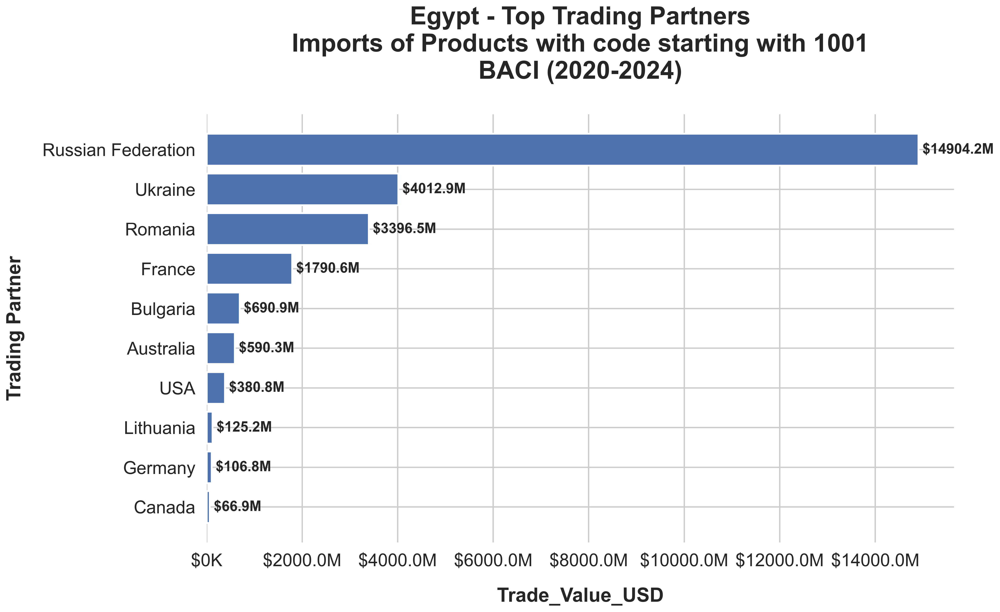

# International Trade Analyzer

A Python tool for analyzing international bilateral trade flows using two complementary data sources: the **BACI database** and the **UN COMTRADE API**.

---

## Overview

The International Trade Analyzer enables researchers, economists, policy analysts, and trade professionals to explore and visualize global trade patterns with ease. Whether you're investigating a country's top trading partners for a specific commodity or analyzing trade trends over three decades, this tool provides the flexibility and depth needed for robust trade analysis.

Every query produces a folder with an Excel workbook holding the full query data and its analysis, report-ready charts, a Word report and a Markdown summary.

### Key Features

- **Dual Data Source Support**
  - **BACI Database**: Harmonized bilateral trade data from 1995-2024 (annual), where discrepancies between exporter and importer reports are reconciled
  - **UN COMTRADE API**: Trade data from 1962-present with annual and monthly frequency options, as reported by countries

- **Three Ways to Run**
  - Interactive: a guided step-by-step workflow with input validation and fuzzy country-name suggestions
  - Command line: one query in one command, for scripts and repeatable work
  - Batch: a CSV file with one query per row (`batch_example.csv` shows each kind of query)

- **Flexible Analysis Options**
  - Analyze trade with all partners, optionally with a focus on one partner
  - HS (Harmonized System) product codes at 2-digit, 4-digit, and 6-digit levels, or `TOTAL`, `AG2`, `AG4`, `AG6`
  - Product detail down to HS 6-digit products from both sources

- **Analysis by Period and for the Whole Period**
  - Totals, shares and rankings by year (or month) and over the whole query
  - Year-on-year growth, CAGR and trend growth; constant-dollar values deflated by the US CPI
  - Concentration (HHI), new and lost partners, unit values

- **The Databases As They Are: Nothing Estimated**
  - Every figure comes from the records the database gives for it. COMTRADE's totals are its own figures for the code you ask for with partner World, the same as on the COMTRADE website; partner and product figures are its own records for them. Figures are added up from a lower level only where COMTRADE leaves its own figure empty, and the report says so
  - A value the source does not report is shown as **Missing**, and so is every total, share or growth rate that depends on it
  - A Data gaps sheet lists every missing data point, so you can decide where to get it
  - Figures the database itself estimated (COMTRADE flags some weights and quantities as UN Comtrade estimates) are used as the database gives them and clearly marked: in blue in the workbook, in a Source estimates sheet, and in the findings and chart notes
  - HS editions stated: BACI uses HS 1992 codes for every year, while COMTRADE keeps each country's data in the HS edition it reported in. The product list shows which editions each code exists in, and the workbook says when a query's data spans more than one edition

- **One Set of Units for Both Databases**
  - Money in million USD, weights in metric tons, unit values in USD per metric ton, in every table, chart and report
  - Quantity stays as the database gives it: metric tons in BACI, and in COMTRADE the product's own unit (kg, number of items, litres...). Quantities in different units are never added: when a query's products use more than one unit, the program refuses quantity, shows which products share a unit, and points to value or net weight
  - The Raw data sheet keeps each database's own units: thousand USD and metric tons for BACI, USD and kg for COMTRADE

- **Professional Outputs**
  - Excel workbook: raw data, yearly and whole-period analysis, partner and product tables, data gaps, native Excel charts
  - Report-ready charts in one house style
  - Word report and Markdown summary with automatically written key findings

- **Fast BACI Queries**
  - A one-time conversion of the BACI CSV files to Parquet makes each year load in a fraction of a second

---

## Quick Start

```bash
# Clone the repository
git clone https://github.com/MoamenAbdelkawy/InternationalTradeAnalyzer.git
cd InternationalTradeAnalyzer

# Install dependencies
pip install -r requirements.txt

# Run the analyzer (interactive)
python trade_analyzer.py

# Or run one query from the command line
python trade_analyzer.py --source baci --reporter Egypt --product 1001 --flow M --period 2015-2024

# Or run every query of a CSV file
python trade_analyzer.py --batch batch_example.csv
```

> **Note**: You'll need to download the BACI database and obtain a COMTRADE API key before using the tool. See the [Usage Guide](Usage_Guide.md) for detailed setup instructions.

---

## Data Sources

### BACI Database (CEPII)

BACI (Base pour l'Analyse du Commerce International) provides reconciled bilateral trade data where discrepancies between exporter-reported and importer-reported values have been harmonized using a sophisticated algorithm.

- **Coverage**: 1995-2024 (annual data)
- **Classification**: HS92 (Harmonized System 1992); CEPII converts every year to this edition
- **Metrics**: Trade Value (thousand USD in BACI), Quantity (Metric Tons)
- **Source**: [CEPII BACI Database](https://www.cepii.fr/DATA_DOWNLOAD/baci/doc/baci_webpage.html)

### UN COMTRADE API

The United Nations COMTRADE database is the largest repository of international trade statistics, providing data as reported by individual countries.

- **Coverage**: 1962-present (annual and monthly data)
- **Classification**: HS (Harmonized System), in the edition each reporter used each year (HS 1992 to HS 2022)
- **Metrics**: Primary Value, FOB Value, CIF Value, Quantity, Net Weight, Gross Weight
- **Source**: [UN COMTRADE](https://comtradeplus.un.org/)

---

## Project Structure

```
InternationalTradeAnalyzer/
├── trade_analyzer.py          # Questions, command line and data loading (BACI, COMTRADE)
├── trade_report/              # Analysis, charts, workbook, Word report and summary
├── tests/                     # Tests: python -m unittest discover -s tests
├── requirements.txt           # Python dependencies
├── batch_example.csv          # Example queries for --batch
├── SUBSCRIPTION_KEY.env       # API credentials (user-configured)
├── LICENSE                    # MIT License
├── README.md                  # This file
├── Usage_Guide.md             # Detailed setup and usage instructions
│
├── comtradeapicall-main/      # UN COMTRADE API wrapper package
│   └── src/comtradeapicall/   # API modules
│
├── data/
│   ├── BACI/                  # BACI database files (user-downloaded)
│   │   └── BACI_HS92_V202601/ # Extracted BACI data (+ parquet/ cache, once built)
│   └── meta/                  # Reference data: country and product codes,
│                              # US CPI table, HS edition table
│
└── output/                    # One folder per query
    └── Egypt_imp_HS1001_2015-2024_BACI/
        ├── Egypt_imp_HS1001_2015-2024_BACI.xlsx
        ├── report.docx
        ├── summary.md
        └── charts/            # PNG charts
```

---

## Sample Output

### Bar Chart: Top Trading Partners


### Workbook sheets

| Sheet | Contents |
| --- | --- |
| About | The query, the source and the HS edition of its data, how missing data and the source's estimates are recognised, definitions, checks and a linked list of sheets |
| Summary | Key figures, key findings, totals by year and the overview chart |
| Yearly (or Monthly) | One row per period: totals, growth, unit value, number of partners, the largest partner, concentration, the share of each total the source estimated; growth over the whole period |
| Suppliers (or Markets) | Every partner over the whole query: totals, share, growth, CAGR, change in share and status |
| ... by year, Shares by year, Growth by year | Partner by period tables |
| Products, Products by year | The same by HS product, with each code's HS editions when the data spans more than one |
| Partner focus, Partner products | When a partner is chosen |
| Data gaps | Every data point the source does not report |
| Source estimates | Every figure the database itself marks as an estimate (COMTRADE), used as given |
| Raw data | Every record of the query, exactly as the source delivers it (for COMTRADE, including its partner World totals), as an Excel table |
| Charts | Every chart |

---

## Requirements

- Python 3.11 to 3.14 (the pinned packages are not yet available for newer versions)
- The packages in `requirements.txt`, installed with `pip install -r requirements.txt`:
  - pandas, numpy, matplotlib
  - pyarrow (fast BACI reading and the Parquet cache)
  - XlsxWriter (workbook), python-docx (Word report)
  - python-dotenv (API credentials), comtradeapicall (COMTRADE API)

---

## Documentation

For detailed setup instructions, including:
- Downloading and installing Python
- Cloning the repository
- Obtaining and configuring data sources
- Step-by-step usage guide, command-line and batch use
- What each output contains

Please see the **[Usage Guide](Usage_Guide.md)**.

---

## License

This project is licensed under the **MIT License** - see the [LICENSE](LICENSE) file for details.

The MIT License is a permissive open-source license that allows you to:
- Use the software for any purpose (personal, academic, commercial)
- Modify the source code
- Distribute copies of the original or modified software
- Include it in proprietary projects

The only requirement is that the original copyright notice and license text must be included in any copies or substantial portions of the software.

---

## Author

**Moamen Abdelkawy**

- Email: [moamen.abdelkawy@outlook.com](mailto:moamen.abdelkawy@outlook.com)
- GitHub: [Moamen-Abdelkawy](https://github.com/Moamen-Abdelkawy)

---

## Contributing

Contributions, suggestions, and bug reports are welcome! Please feel free to:

1. Open an issue to report bugs or suggest features
2. Submit a pull request with improvements
3. Contact me directly via email

---

## Acknowledgments

- **CEPII** for the BACI database
- **United Nations Statistics Division** for the COMTRADE database and API
- **The World Bank** for the consumer price index series
- The open-source Python community for the excellent libraries that make this project possible

---

## Citation

If you use this tool in your research, please consider citing it:

```
Abdelkawy, M. (2026). International Trade Analyzer [Computer software].
https://github.com/MoamenAbdelkawy/InternationalTradeAnalyzer
```

---

*Last updated: October 2026*
